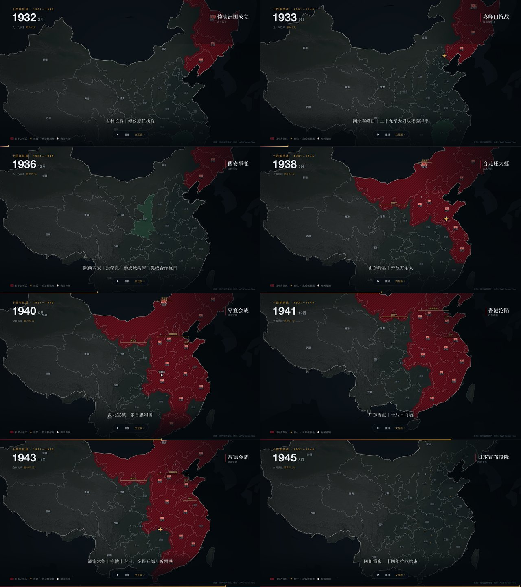

# 锋线 · 近代中国战事地图 1840—1949

1840 到 1949 年间 158 条战事，编成 20 场战役、145 个关键节点，落到地图上。点播放，时间沿着战役的节点往前跳：每到一个节点，年份钉住，这一处的点位亮起、行军路线按箭头方向画出来，停一下再走下一节。

纯静态单页，零构建、零依赖、零外部请求。底图是本地自绘的 Canvas 矢量图，地形是按今日高程数据**离线烘好的一张位图**（`data/geo/terrain.webp`，247 KB），运行时不拉任何在线瓦片，断网也能跑。



另有一个**影片模式**（`cinema.html`）：只讲抗战十四年，22 节、1280×720 的视频版式——红色斜线是日军占领区，旭日旗跟着侵略一路铺开，金色是胜仗与敌后根据地，白色火苗是殉国的将领。它复用同一套数据与底图，把交互界面的侧栏、时间轴全收掉，只留一条进度条。左栏底部的「影片模式」入口进去，影片里的「交互版」回来。

## 跑起来

```bash
cd war-map
python3 -m http.server 4322
# 打开 http://127.0.0.1:4322/
```

必须用 HTTP 打开，不能双击 `index.html`：模块脚本与 `fetch` 在 `file://` 下会被浏览器拦掉。

## 操作

| 动作 | 效果 |
| --- | --- |
| 播放 / 暂停 | 沿战役节点推进；每节按战事数停留 1.0–3.0 秒，节点之间的过渡是 0.4 秒的插值 |
| ◀ / ▶ | 跳到上一节 / 下一节（不播放） |
| 拖年表尺 | 跳到任意年份；此时离开节点模式，年份自由滚动，靠近下一节时会吸附回去 |
| 点时期索引 | 跳到该时期的第一节 |
| 点地图上的点 | 打开档案卡；只是「查看」，不会挪动此刻的时间轴位置 |
| 滚轮 | 缩放（1×–2.6×）；一旦自己缩放过，就不再抢镜头，直到复位或点时期索引 |
| 空格 / ← → / Home | 播放暂停 / 前后一节 / 回到开头 |
| Esc | 关档案卡或关于弹层 |

停在最后一节再按播放，从头重看。窄屏（≤860px）下左栏折成顶部横条，战事流收进底部抽屉，由时间轴右侧的「战事流」按钮开合；≤430px 时「倍速」按钮收起（拖年表尺本来就能跳），播放时也不再自动弹档案卡——地图就那么大，弹出来正好压在刚亮起来的点上。

## 怎么读

- **节点**是这台戏的节拍。一场战役切成若干节点，每节挑几个关键地名（珠江口、虎门、吴淞、镇江…）。左栏第二行是「第几节 / 共几节」和这一节的名字，下面那条细杠是这一节的停留进度。
- **同一节可能有两三处战事**（比如「圆明园被焚、《北京条约》」）。地图上用淡虚线把它们串起来，只给落点那处挂名字，战事流里标注「同刻 2 处」。
- **符号形状是兵种**：方框打叉步兵、方框一斜骑兵、船形舰队、五边形炮台要塞、双圈条约事变这类政治事件。**符号颜色是阵营**：金中国政府军、绿起义与革命武装、红日本、蓝西方列强、紫俄国——每条战事只标主角那一方。**符号大小是规模**：小局部战斗、中战役、大决定性会战。左栏时期行首的小色点仍是时期配色，和地图上未发生的淡点同源。
- **箭头颜色跟发起方走**（同一个阵营色，底下压一道暗边），线型区分陆上推进、海上行动与撤退；同一节里只画这一节的机动，最长的一条先画、带番号，其余压细——满屏箭头等于什么都没说。大沽口到天津这种只隔几公里的近距机动，屏幕上不足十像素，按最小可读长度拉伸，方向照实。
- **省面的颜色是控制方**，用的是同一个阵营色。整幅本土都压着一层很淡的暖色，那是中国政府方面（底色）——不压这一层，政府方面就没有「主」，读起来像无人区。控制易手的那一节，相关省份按离战场远近依次翻色，先近后远、成「波」不齐闪；被占领区是进攻方的纯色——半透明叠半透明只会得到浑浊的第三色。
- **底图是地形**：越亮越高，山脊、盆地、河谷都在。按今日高程离线烘焙，只给空间感，不代表当时的植被或耕地。
- **实线**是陆上推进，**虚线**是海上行动，**点划线**是撤退转移。箭头只画当前时期最近几条，加上当前节点那几条——否则 1876 年横贯新疆的长箭头会一直挂到 1911 年的图上。
- **淡点**是尚未发生的战事，给一个空间上的预告，让任何年份的图都不空。
- 拖着年表尺停在两场战役之间时，栏里显示「间歇」并告诉你下一场在哪一年。

## 目录

```
war-map/
├── index.html          页面骨架（交互版）
├── cinema.html         影片模式：只有一张 canvas 与一条进度条
├── styles.css          全部样式（含断点与 prefers-reduced-motion 兜底）
├── cinema.css          影片模式的样式（控制条悬停才出现）
├── src/
│   ├── geo.js          Albers 等积圆锥投影、视口变换、Haversine
│   ├── timeline.js     时间轴纯函数（revealedCount / eraAt / playbackSpeed）
│   ├── nodes.js        战役节点：展开、定位、停留时长、节点播放器（node / free 两模式）
│   ├── render.js       Canvas 2D 手绘：海、地形、邻国、省界、河流、控制区、符号、箭头、标签、图例
│   ├── control.js      控制区累计态：变化点 → 逐节快照、成波顺序、翻色透明度
│   ├── app.js          装配层：尺寸、镜头、rAF 主循环、播放、战事流、档案卡、事件绑定
│   ├── cinema.js       影片模式的一帧：斜线占领区、旭日旗、火苗、金星、年份与字幕
│   ├── cinema-app.js   影片模式的装配层：22 节、镜头推近、进度条
│   └── kit/            绘图组件库（与数据无关，可移植到别的地图）
│       ├── ease.js     缓动、颜色（hex 与 rgb() 都认）
│       ├── hatch.js    45° 斜线填充纹样（离屏缓存）
│       ├── marks.js    旭日旗、火苗、八角星、括号、印章
│       ├── overlay.js  暗角、字幕带、年份牌、战役标题、图例、天数行
│       └── index.js    统一出口
├── data/
│   ├── events.js       158 条战事 + 13 个时期
│   ├── campaigns.js    20 场战役 + 145 个节点（引用 events 的 id）
│   ├── units.js        阵营与兵种：每条战事的 [阵营, 兵种]，以及阵营配色
│   ├── control.js      控制区变化点：哪一节之后哪些省归谁
│   └── geo/
│       ├── basemap.json    运行时底图（93 KB，由构建脚本生成）
│       ├── terrain.webp    地形图（2200×1959，247 KB，由烘焙脚本生成）
│       └── raw/            原始 GeoJSON 与瓦片缓存
├── tools/
│   ├── build-geo.mjs   底图构建：投影 → Douglas–Peucker 抽稀 → 裁环 → 写 basemap.json
│   └── bake-terrain.py 地形烘焙：Terrarium 高程 → 分层设色 + 晕渲 → terrain.webp
└── tests/              node --test，103 个用例
```

## 数据

### 一条战事（`data/events.js`）

```js
{
  id: "jw-1894-yalu",          // 时期前缀 + 年月 + 短名
  date: "1894-09-17",
  era: "jiawu",                 // 必须存在于 ERAS
  name: "黄海海战",
  place: "黄海大东沟",
  at: [123.0, 39.0],            // [经度, 纬度]
  scale: 3,                     // 1 局部战斗 / 2 战役 / 3 决定性会战
  result: "北洋水师损失五舰，退守威海卫",
  note: "……",
  arrows: [                     // 可选
    { kind: "naval", label: "北洋舰队", pts: [[121.6, 38.9], [123.0, 39.0]] },
  ],
}
```

13 个时期：鸦片战争 13 条、太平天国 16、第二次鸦片战争 9、捻军与回变 7、中法战争 9、甲午战争 11、八国联军 7、日俄战争 8、辛亥革命 10、军阀混战与北伐 14、土地革命 13、抗日战争 25、解放战争 16。时期允许重叠（如太平天国与捻军回变同期），`eraAt` 取「开始得更晚」的那个。

### 一场战役（`data/campaigns.js`）

```js
{
  id: "jw-1",
  name: "甲午战争",
  era: "jiawu",
  blurb: "……",                 // 左栏那一行简介
  nodes: [
    { title: "丰岛海战", events: ["jw-1894-fengdao"] },
    { title: "平壤之战", events: ["jw-1894-pyongyang"] },
    // …
  ],
}
```

节点的时刻取组内最后一条战事的日期；节点的规模取组内最大的 `scale`。`src/nodes.js` 的 `buildNodes()` 会把战役展开成 145 个节点，并做三件事的硬校验——重复引用同一条战事、引用不存在的 id、有战事没被编进任何节点，都会直接抛错（错误信息带 id）。同刻的节点按战役定义顺序稳定排序。

### 一条符号（`data/units.js`）

```js
UNITS = {
  "jw-1894-yalu": ["gov", "nav"],   // 阵营, 兵种
}
```

阵营（`FACTIONS`）：`gov` 中国政府军、`rev` 起义与革命武装、`jp` 日本、`west` 西方列强、`ru` 俄国。兵种（`ARMS`）：`inf` 步兵、`cav` 骑兵、`nav` 舰队、`fort` 炮台要塞、`pol` 政治事件。158 条战事每条都有登记，`tests/units.test.mjs` 会核对没有遗漏、没有悬空 id。记的是**叙事上的主角**（发起方，或更该被看到的那一方），不是双方兵力表。

### 一处控制变化（`data/control.js`）

```js
{ node: "aj-2/1", set: { 北平: "jp", 天津: "jp", 河北: "jp" } }
```

只在「控制真的变了」的那一节记一条，后写覆盖先写；`gov` 是底色，从占领区退出就是把省设回 `"gov"`。`src/control.js` 会把 38 条变化点展开成「每一节之后的全图状态」，并算出翻色的先后顺序（按省到战场的投影距离，由近及远）。

这是**编辑判断**，不是史料里的行政边界：底图只有 33 个近代省名，粒度就是「一省易手」。战线上真正的犬牙交错、只占几县不占全省的情况，这里做不到，也不假装做到——画出来的是大势，不是战线。

### 加一条战事

1. 在 `data/events.js` 的 `EVENTS` 里加一项，`era` 用已有的时期 id；
2. 在 `data/campaigns.js` 里把它塞进某场战役的某个 `nodes[].events`——不塞的话 `buildNodes()` 会抛「有战事没有编入任何节点」；
3. 在 `data/units.js` 的 `UNITS` 里给它一个 `[阵营, 兵种]`——不登记 `tests/units.test.mjs` 会红；
4. 若这一节改变了某省的控制方，在 `data/control.js` 里补一条；
5. 跑测试：

```bash
node --test tests/*.test.mjs
```

`tests/data.test.mjs` 校验字段类型、id 唯一、日期在 1840–1950 内、`era` 存在、坐标与箭头端点投影后都落在底图 bbox 内、时期裂缝不超过 10 年；`tests/nodes.test.mjs` 校验节点覆盖完整与播放器语义。

## 重建底图

原始数据在 `data/geo/raw/`：

- `china-provinces.json` — 阿里 DataV 全国省级面（33 个省级单元）
- `world.geo.json` — 世界国界（取邻国与国界轮廓）
- `rivers.geojson` — Natural Earth 50m 河流

```bash
node tools/build-geo.mjs     # 或 npm run build:geo
```

地形由 `tools/bake-terrain.py` 烘焙（需要 numpy 与 Pillow）：

```bash
python3 tools/bake-terrain.py --width 2200
```

它从 AWS Terrain Tiles（Terrarium 编码，公有领域）抓高程，缓存到 `data/geo/raw/terrain-tiles/`（z=7 共 713 张、约 51 MB，已加进 `.gitignore`），再用**与 `src/geo.js` 完全相同的 Albers 反投影**逐像素反算经纬度采样，输出与底图严格对齐的分层设色 + 晕渲位图。脚本自带一致性自检：Python 的 `unproject()` 与 JS 的 `project()` 互逆误差 1e-14。

三个调参要点：`--vexag 3.5` 必开（输出约 2.3 km/像素，真实坡度在这个尺度上几乎看不见）；海面要压平（`e = max(e, 0)`，否则海底沟壑顺着海岸线渗进来糊掉陆海分界）；高段特意压暗（高原一旦逼近白色，琥珀与朱红的符号就全被吞掉）。深色底图上不要用 `overlay` 贴灰度遮罩——那只会把暗部压得更暗。

脚本用 `src/geo.js` 的同一套投影，所以底图和战事点位永远对齐。抽稀容差在文件头：`TOL_CN = 0.0009`、`TOL_WORLD = 0.0035`、`TOL_RIVER = 0.0012`；视域 `LON = [72,148]`、`LAT = [-2,56]`；bbox 最终以国界轮廓外扩 8.5%–14% 为基准。省名在 `CN_NAME` 表里做了民国化映射（北平、绥远、陕西…），邻国在 `WORLD_KEEP` 白名单里只留 24 个，并给了中文名（俄国、暹罗、荷属东印度…）。

## 测试

```bash
node --test tests/*.test.mjs     # 103 passed
```

- `tests/nodes.test.mjs` — 每条战事恰好属于一个节点、节点时间单调、取组内末条时刻、三种数据错误会抛、同刻稳定排序；`nodeIndexAtYear` 二分与线性扫描一致；`next/prevNodeIndex` 严格跨越；停留时长夹取；播放器逐节点推进、过渡期年份在两节之间、`tick` 不重复上报、末节点自停、终点再播放回卷、`seekNode`/`seekFree` 语义、拖年表尺后起播不倒退
- `tests/timeline.test.mjs` — 二分查找与线性扫描一致、邻站互逆、重叠时期取值、播放速度在空档年与密集年的方向、freshness 窗口
- `tests/data.test.mjs` — 战事数据完整性与底图结构（省 ≥30、邻国 ≥15、河 ≥8、省名已民国化、basemap < 200 KB）
- `tests/geo.test.mjs` — 投影互逆、`createView` 等比缩放与居中、`createInsetView` 的空闲区贴合、Haversine 京沪距离
- `tests/units.test.mjs` — 每条战事都有符号、没有悬空 id、阵营与兵种键都已定义、每个阵营每个兵种都用上了、六条政治事件必须归 `pol`
- `tests/kit.test.mjs` — 缓动端点与单调性、`parseHex` 兼容 hex 与 `rgb()/rgba()`（曾因只认 hex 把斜线刷成纯白）、`lighten` 二次调用不变白、斜线纹样尺寸随 DPR 放大且恒为正整数、字幕折行按宽度切且不超行数上限
- `tests/control.test.mjs` — 控制点引用的节点/省名/阵营都真实存在、累计态单调（没被点名的省不会无故变色）、重复声明不算变化、`controlAt` 夹取、几条史实链（香港 1841 west → 1942 jp → 1945 归还、东北 1931 jp → 受降 gov → 辽沈 rev）、翻色顺序按距离且延迟不超 0.6、翻色透明度边界

## 影片模式与组件库

`cinema.html` 是同一份数据的另一种看法：不是让读者去点，而是从头放到尾。它只取抗战那 25 条战事、22 节，整帧用 Canvas 画完（年份、战役名、字幕都在画里，不靠 DOM 叠），这样任何一帧都能直接截图当封面。

`src/kit/` 是从这一轮里抽出来的**可复用绘图组件**——它们不认识战事数据，也不读页面状态，只接「上下文 + 参数」：

| 组件 | 用途 |
| --- | --- |
| `ease.js` | `clamp/lerp/easeOut/smoothstep/pulse/window01`；`parseHex/rgba/mixColor/lighten` 颜色工具（hex 与 `rgb()` 都认） |
| `hatch.js` | `hatchPattern(opts)` 生成 45° 斜线 `CanvasPattern`，按参数 key 缓存离屏画布；`hatchFill(ctx, path, opts)` 直接填充 |
| `marks.js` | `drawRisingSun`（旭日旗）、`drawFlame`（火苗）、`drawStar`（八角星）、`drawBracket`（上括号）、`drawSeal`（印章）、`halo`（统一暗底描边） |
| `overlay.js` | `drawVignette`、`drawCaptionBand`、`drawYearCard`、`drawDayCount`、`drawTitleCard`、`drawCaption`、`drawKicker`、`drawFilmLegend`、`drawSource`、`drawLetterbox`、`wrapLines` |

用法一律是「先算位置，再画」：

```js
import { drawRisingSun, hatchPattern, drawYearCard } from "./kit/index.js";

const pat = hatchPattern(ctx, { color: "rgb(96,18,28)", bg: "rgb(84,16,25)", period: 4.4, width: 2.2, angle: 45 });
ctx.fillStyle = pat;
ctx.beginPath(); /* …省界路径… */ ctx.fill("evenodd");

drawRisingSun(ctx, x, y, 24);        // 白底红放射 + 旗杆
drawYearCard(ctx, 60, 100, 1937, 7); // 「1937」+「7月」
```

几条从参考片里量出来、写进代码的经验（都踩过）：

- **占领区要「暗红成片」，不是几根亮线。** 底色与条纹都做成不透明的深红（`mixColor(color, "#000", 0.46)` 与 `0.26`），别拿半透明去和地形混——混出来发灰发粉，正是早期版本比参考片「淡」一个数量级的原因。
- **省与省的缝隙要糊上。** 填完省面再用同一个 pattern 沿省界描 `lineWidth: 22` 的一圈，占领区才读成一整片，而不是几块分开的补丁。
- **只有占领区用斜线。** 革命根据地改用淡平铺色 + 金色括号，不与占领区抢视觉主语。
- **镜头别推太近。** 战区占画面 64%、zoom 上限 1.75：再近就把「这里离哪儿近」的参照挤出画面，占领区的红占比反而骤降。
- **点击进度条要吸附到最近的一节。** 画面是按节点讲的，年份与字幕必须对得上；自由年份会出现「写着 1935、说的却是 1933 那一节」。

## 部署到 GitHub Pages

站点是纯静态的，把 `war-map/` 目录内容推到仓库根（或 `docs/`），在仓库 Settings → Pages 里选对应目录即可。没有构建步骤，不需要 Actions。

`data/geo/raw/` 有 1.6 MB，只在重建底图时用到。只想发布站点可以不带它：

```bash
rsync -a --exclude 'data/geo/raw' war-map/ /path/to/pages-repo/
```

## 边界说明

底图是现代省界与国界的简化几何，只用于定位，不表示任何历史时期的疆域主张。地名尽量采用当时的称法（北平、绥远、荷属东印度），但省界本身无法还原到民国时期。坐标取自事件实际发生地，部分古地名按今地换算，存在数公里级误差。战役的节点切分与命名是编辑判断，不同史著分段不一，这里取的是便于在地图上讲清楚的那一种。

## 素材来源

- 地形：[AWS Terrain Tiles](https://registry.opendata.aws/terrain-tiles/)（Terrarium 编码，公有领域）
- 省界：[阿里云 DataV.GeoAtlas](https://geo.datav.aliyun.com/)（100000_full）
- 国界：[johan/world.geo.json](https://github.com/johan/world.geo.json)
- 河流：[Natural Earth](https://www.naturalearthdata.com/) 50m physical rivers

投影为 Albers 等积圆锥（`lon0 = 105°`、`lat0 = 35°`、`lat1 = 25°`、`lat2 = 47°`）。
